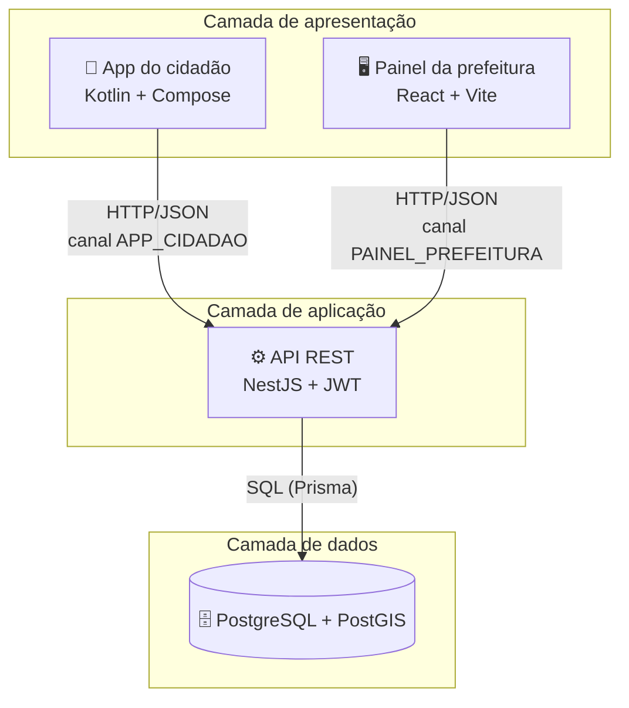
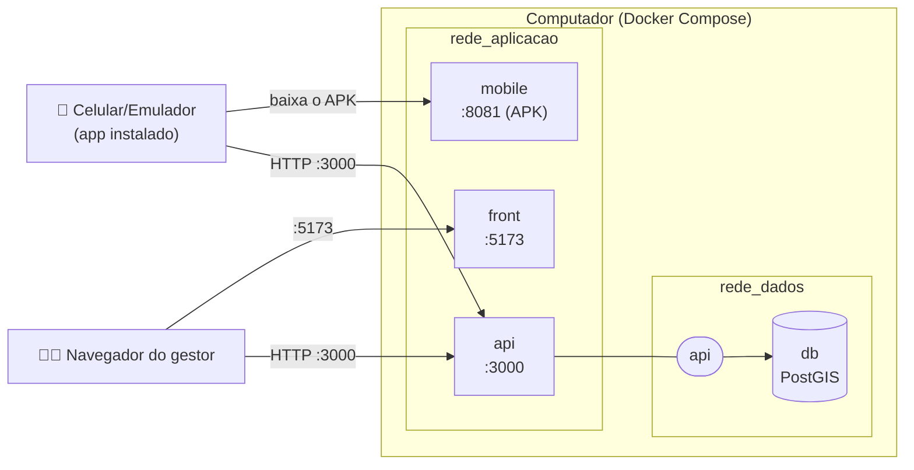
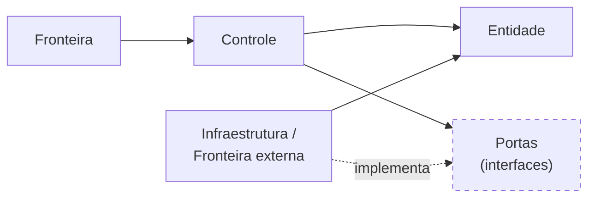
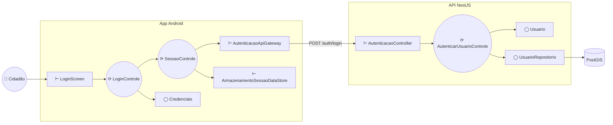
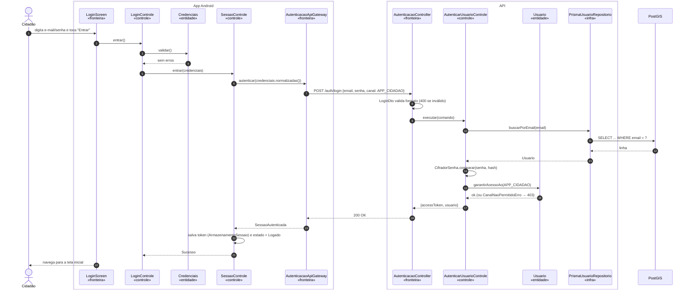

# SOS Manaus: Documento de Arquitetura

> Escopo atual: caso de uso **Fazer login** (RFA_02), implementado de ponta a ponta na API e no app Android.
> O painel da prefeitura existe como container, mas ainda é um esqueleto.

**Sumário**

1. [Visão geral em camadas](#1-visão-geral-em-camadas)
2. [Containers e redes (Docker Compose)](#2-containers-e-redes-docker-compose)
3. [O padrão Fronteira → Controle → Entidade](#3-o-padrão-fronteira--controle--entidade)
4. [BCE na API (NestJS)](#4-bce-na-api-nestjs)
5. [BCE no app Android (Kotlin + Jetpack Compose)](#5-bce-no-app-android-kotlin--jetpack-compose)
6. [O caso de uso "Fazer login" atravessando as camadas](#6-o-caso-de-uso-fazer-login-atravessando-as-camadas)
7. [Testes por camada](#7-testes-por-camada)
8. [Como criar um novo caso de uso seguindo o padrão](#8-como-criar-um-novo-caso-de-uso-seguindo-o-padrão)

A avaliação das decisões arquiteturais está em [`AVALIACAO-DECISOES.md`](AVALIACAO-DECISOES.md).

---

## 1. Visão geral em camadas

O sistema segue uma **arquitetura cliente-servidor em camadas**. Cada camada só conversa com a camada imediatamente abaixo:

| Camada | Componente | Tecnologia | Responsabilidade |
|---|---|---|---|
| **Apresentação (mobile)** | App do cidadão | Kotlin + Jetpack Compose | Interface do cidadão: login, registrar e acompanhar ocorrências |
| **Apresentação (front)** | Painel da prefeitura | React + Vite (TypeScript) | Interface do gestor público: gerenciar ocorrências |
| **Aplicação** | API REST | Node.js + NestJS (TypeScript) + JWT | Regras de negócio, autenticação, autorização e acesso aos dados |
| **Dados** | Banco de dados | PostgreSQL + PostGIS | Persistência, incluindo dados geoespaciais das ocorrências |



**Regras entre camadas**

- Os clientes (mobile e front) **nunca** acessam o banco. Toda leitura e escrita passa pela API.
- A API é a **única fonte das regras de negócio**. Os clientes validam formato apenas para dar retorno rápido ao usuário, e a API valida de novo.
- Os clientes se identificam por um **canal** (`APP_CIDADAO` ou `PAINEL_PREFEITURA`). A API decide quais perfis podem usar cada canal.

---

## 2. Containers e redes (Docker Compose)

Cada camada roda em **um container próprio**, todos definidos no mesmo `docker-compose.yml`:

| Serviço | Imagem / build | Porta no PC | Redes | O que faz |
|---|---|---|---|---|
| `db` | `postgis/postgis:16-3.4` | — (não exposta) | `rede_dados` | Guarda os dados. Tem healthcheck com `pg_isready` |
| `api` | `./backend/Dockerfile` | `3000` | `rede_dados` + `rede_aplicacao` | Aplica as migrações, roda o seed e sobe a API. Healthcheck em `GET /health` |
| `front` | `./frontend/Dockerfile` | `5173` | `rede_aplicacao` | Build do Vite servido por Nginx |
| `mobile` | `./android/Dockerfile` | `8081` | `rede_aplicacao` | Compila o APK com Gradle e Android SDK, roda os testes JUnit e publica o APK para download |



**Decisões importantes do compose** (justificadas no ADR-09 da avaliação):

- **Redes separadas:** só a `api` participa da `rede_dados`. Mesmo que o container do front ou do mobile fosse comprometido, ele não teria rota até o banco.
- **Banco sem porta exposta:** para inspecionar o banco em desenvolvimento, use `docker compose -f docker-compose.yml -f docker-compose.dev.yml up -d`.
- **Ordem de subida com healthchecks:** `db` saudável → `api` saudável → `front` e `mobile`.
- **Segredos fora do código:** `JWT_SECRET` vem do `.env`, e o compose recusa subir sem ele.
- **Container mobile:** um app Android não "roda" dentro de um container, ele roda no celular ou no emulador. Por isso o container da camada mobile é o **ambiente de build e distribuição**. Ele compila o APK num ambiente reprodutível (JDK 17, Android SDK 36, Gradle 8.14), roda os testes e serve o APK em `http://localhost:8081`.

---

## 3. O padrão Fronteira → Controle → Entidade

O padrão **BCE** (*Boundary–Control–Entity*) foi proposto por Ivar Jacobson no método OOSE e é o que se usa nos **diagramas de robustez** (ICONIX) para ligar os casos de uso ao código. Cada classe recebe um de três estereótipos:

| Estereótipo | Símbolo UML | Pergunta que responde | No SOS Manaus |
|---|---|---|---|
| **Fronteira** (*boundary*) | ⊢○ | *Como o sistema conversa com o mundo de fora?* | Telas Compose, controllers HTTP, DTOs, cliente da API, armazenamento local |
| **Controle** (*control*) | ○ com seta | *Qual é o fluxo do caso de uso?* | `AutenticarUsuarioControle`, `SessaoControle`, `LoginControle` |
| **Entidade** (*entity*) | ○ sublinhado | *Quais dados e regras de negócio existem?* | `Usuario`, `Credenciais`, `Perfil`, `Canal`, `EstadoSessao` |

### 3.1 Regras de comunicação (regras de robustez)

| De ↓ / Para → | Ator | Fronteira | Controle | Entidade |
|---|---|---|---|---|
| **Ator** | — | ✅ | ❌ | ❌ |
| **Fronteira** | ✅ | ✅ | ✅ | ⚠️ só lê dados (ver nota) |
| **Controle** | ❌ | ✅ (via portas) | ✅ | ✅ |
| **Entidade** | ❌ | ❌ | ❌ | ✅ |

Em resumo:

1. O **ator** (cidadão, gestor, sistema externo) só fala com **fronteiras**.
2. A **fronteira** nunca aplica regra de negócio e nunca acessa banco nem repositório: ela entrega o pedido ao **controle**.
3. O **controle** coordena o caso de uso: busca entidades, chama as regras delas e decide o próximo passo.
4. A **entidade** não depende de nada: nem de framework, nem de banco, nem de HTTP.

> **Nota (decisão consciente):** a fronteira pode *receber e exibir* dados que vêm do controle, mesmo quando o tipo está declarado na camada de entidade (por exemplo, a tela inicial recebe um `Usuario` para mostrar o nome, e o `LoginDto` usa o enum `Canal` para validar o formato). O que a fronteira **não pode** é chamar regras de negócio, criar ou persistir entidades. Isso evita duplicar classes "espelho" só para atravessar a camada. O ADR-02 discute esse trade-off.

### 3.2 Complemento: portas e infraestrutura

O BCE clássico não diz onde ficam o banco, o bcrypt ou o JWT. Se o controle usasse essas bibliotecas diretamente, ele ficaria preso a elas e só poderia ser testado com banco de verdade. Por isso aplicamos o **Princípio da Inversão de Dependência**:

- O **controle** declara uma **porta** (interface/classe abstrata) com o que precisa: `UsuarioRepositorio`, `CifradorSenha`, `EmissorToken` (API); `AutenticacaoGateway`, `ArmazenamentoSessao` (app).
- Uma classe de **infraestrutura** (na API) ou de **fronteira com sistema externo** (no app) implementa a porta: `PrismaUsuarioRepositorio`, `BcryptCifradorSenha`, `AutenticacaoApiGateway`...
- A ligação entre a porta e a implementação acontece **num único lugar**: `autenticacao.module.ts` na API e `AppContainer` no app.



**Direção das dependências:** todas as setas apontam para dentro, para a entidade. Trocar Prisma por outro ORM, ou Retrofit por Ktor, não exige mudar nenhuma linha de controle ou entidade.

---

## 4. BCE na API (NestJS)

### 4.1 Estrutura de pastas

```
backend/src/
├── main.ts                         ponto de entrada
├── configurar-app.ts               configuração da fronteira HTTP (pipes, filtros, CORS)
├── app.module.ts                   junta os módulos
├── compartilhado/
│   ├── entidade/erro-dominio.ts            ENTIDADE: classe-base dos erros de regra de negócio
│   ├── fronteira/erro-dominio.filter.ts    FRONTEIRA: converte erro de domínio em resposta HTTP
│   └── infraestrutura/prisma/              INFRA: conexão com o PostgreSQL
└── modulos/
    ├── saude/fronteira/saude.controller.ts FRONTEIRA técnica: GET /health (healthcheck do Docker)
    └── autenticacao/
        ├── autenticacao.module.ts          liga cada porta à sua implementação
        ├── fronteira/
        │   ├── autenticacao.controller.ts  POST /auth/login, GET /auth/me
        │   ├── dto/login.dto.ts            formato e validação da requisição
        │   ├── jwt.strategy.ts             lê e verifica o token que chega
        │   └── jwt-auth.guard.ts           barra rotas sem token
        ├── controle/
        │   ├── autenticar-usuario.controle.ts     caso de uso "Fazer login"
        │   ├── obter-usuario-logado.controle.ts   caso de uso "Obter usuário logado"
        │   └── portas/cifrador-senha.ts, emissor-token.ts
        ├── entidade/
        │   ├── usuario.ts                  entidade Usuario e suas regras
        │   ├── perfil.ts                   Perfil, Canal e a regra "perfil × canal"
        │   ├── erros.ts                    erros de domínio da autenticação
        │   └── usuario.repositorio.ts      contrato de persistência (porta)
        ├── infraestrutura/
        │   ├── prisma-usuario.repositorio.ts
        │   ├── bcrypt-cifrador-senha.ts
        │   └── jwt-emissor-token.ts
        └── testes/usuario-repositorio-em-memoria.ts
```

### 4.2 Classe por classe

| Classe | Camada | Responsabilidade | Não pode... |
|---|---|---|---|
| `AutenticacaoController` | Fronteira | Receber `POST /auth/login` e `GET /auth/me` e chamar o controle | ...conferir senha, consultar banco ou decidir quem pode entrar |
| `LoginDto` | Fronteira | Validar o **formato** (e-mail válido, senha ≥ 6, canal conhecido) e responder 400 | ...validar regra de negócio |
| `JwtStrategy` / `JwtAuthGuard` | Fronteira | Extrair e verificar o token do cabeçalho `Authorization` e pedir o usuário ao controle | ...acessar o repositório diretamente |
| `ErroDominioFilter` | Fronteira | Traduzir `CREDENCIAIS_INVALIDAS → 401`, `CANAL_NAO_PERMITIDO → 403`... | ...decidir *quando* o erro acontece |
| `AutenticarUsuarioControle` | Controle | Normalizar o e-mail, buscar o usuário, comparar a senha, aplicar `garantirAcessoAo(canal)` e emitir o token | ...saber de HTTP, Prisma, bcrypt ou JWT |
| `ObterUsuarioLogadoControle` | Controle | Confirmar a cada requisição que o dono do token existe e está ativo | ...saber de HTTP |
| `CifradorSenha`, `EmissorToken` | Controle (portas) | Dizer *o que* o controle precisa | ...conter implementação |
| `Usuario` | Entidade | Dados do usuário e as regras: ativo? perfil permitido no canal? visão pública sem hash | ...depender de qualquer biblioteca |
| `Perfil`, `Canal`, `PERFIS_PERMITIDOS_POR_CANAL` | Entidade | Regra de negócio: cidadão → app, gestor → painel | — |
| `UsuarioRepositorio` | Entidade (porta) | Contrato: buscar usuário por e-mail ou id | ...citar Prisma |
| `PrismaUsuarioRepositorio` | Infraestrutura | Converter linha do banco ↔ entidade `Usuario` | ...conter regra de negócio |
| `BcryptCifradorSenha`, `JwtEmissorToken` | Infraestrutura | Implementar as portas com as bibliotecas reais | — |

### 4.3 Erros atravessando as camadas

A entidade lança `CanalNaoPermitidoErro`, o controle não captura e a fronteira (`ErroDominioFilter`) converte em HTTP:

```json
HTTP 403
{ "statusCode": 403, "codigo": "CANAL_NAO_PERMITIDO",
  "message": "Esta conta é de gestor. Acesse pelo painel da prefeitura." }
```

O app usa o `codigo` e a `message` sem precisar conhecer a regra.

---

## 5. BCE no app Android (Kotlin + Jetpack Compose)

### 5.1 Estrutura de pastas

```
android/app/src/main/java/br/com/sosmanaus/app/
├── MainActivity.kt                  ponto de entrada Android (aplica o tema e abre a navegação)
├── SosManausApplication.kt          AppContainer: liga portas às implementações
├── fronteira/
│   ├── ui/
│   │   ├── NavegacaoSosManaus.kt    escolhe a tela pelo estado da sessão
│   │   ├── login/LoginScreen.kt     tela de login (ator: Cidadão)
│   │   ├── home/HomeScreen.kt       tela provisória pós-login
│   │   └── tema/Tema.kt             cores do protótipo
│   ├── api/
│   │   ├── SosManausApi.kt          contrato HTTP (Retrofit) + DTOs JSON
│   │   ├── ClienteHttp.kt           OkHttp/Retrofit, timeouts e log sem corpo
│   │   └── AutenticacaoApiGateway.kt  implementa a porta; traduz HTTP ↔ entidade
│   └── armazenamento/
│       └── ArmazenamentoSessaoDataStore.kt  implementa a porta; guarda o token
├── controle/
│   ├── LoginControle.kt             estado e eventos da tela de login (ViewModel)
│   ├── SessaoControle.kt            casos de uso: entrar, restaurar sessão, sair
│   └── portas/
│       ├── AutenticacaoGateway.kt   o que o controle precisa da API
│       └── ArmazenamentoSessao.kt   o que o controle precisa do aparelho
└── entidade/
    ├── Usuario.kt                   Usuario + Perfil
    ├── Credenciais.kt               e-mail/senha + regras de validação e normalização
    └── EstadoSessao.kt              Carregando | Deslogado | Logado(usuario)
```

### 5.2 Classe por classe

| Classe | Camada | Responsabilidade | Não pode... |
|---|---|---|---|
| `LoginScreen` | Fronteira (UI) | Desenhar o card do protótipo e repassar eventos (digitar, Entrar, Criar conta) | ...validar, chamar a API ou guardar token |
| `NavegacaoSosManaus` | Fronteira (UI) | Observar `SessaoControle.estado` e mostrar Login ou Início | ...decidir se a sessão é válida |
| `AutenticacaoApiGateway` | Fronteira (sistema externo) | Converter `Credenciais` → `LoginRequest`, JSON → `Usuario` e HTTP 401/403/429/IOException → `FalhaAutenticacao` | ...ter regra de negócio |
| `ArmazenamentoSessaoDataStore` | Fronteira (aparelho) | Ler, gravar e apagar o token no DataStore | — |
| `LoginControle` | Controle | Manter o `LoginUiState`, validar com `Credenciais.validar()` e pedir login ao `SessaoControle` | ...importar Compose, Retrofit ou DataStore |
| `SessaoControle` | Controle | Fluxo de sessão: autentica pela porta, salva o token, publica `EstadoSessao`, restaura (apaga token vencido, mantém se for só falta de internet) e sai | ...saber que existe HTTP |
| `AutenticacaoGateway`, `ArmazenamentoSessao` | Controle (portas) | Contratos que a fronteira implementa | — |
| `Credenciais` | Entidade | Regras: e-mail obrigatório e válido, senha ≥ 6, normalização | ...depender do Android |
| `Usuario`, `Perfil`, `EstadoSessao` | Entidade | Dados do domínio | ...depender do Android |

> `LoginControle` estende `ViewModel` apenas para sobreviver à rotação da tela. Ele não importa nada de Compose.
> **Entidade e controle são Kotlin puro** e por isso são testados com JUnit comum, sem emulador.

---

## 6. O caso de uso "Fazer login" atravessando as camadas

### 6.1 Diagrama de robustez



### 6.2 Diagrama de sequência



### 6.3 Fluxos alternativos

| Situação | Onde é detectada | Resultado para o cidadão |
|---|---|---|
| Campo vazio, e-mail malformado, senha < 6 | Entidade `Credenciais` (app) | Erro abaixo do campo, sem chamar a API |
| Mesmo caso, mas vindo de um cliente que pulou a validação | `LoginDto` (fronteira da API) | HTTP 400 |
| E-mail inexistente ou senha errada | `AutenticarUsuarioControle` | 401 "E-mail ou senha incorretos." (mesma mensagem nos dois casos) |
| Conta de gestor no app | Entidade `Usuario.garantirAcessoAo` | 403 "Esta conta é de gestor..." |
| Conta desativada | Entidade `Usuario.garantirAcessoAo` | 403 "Esta conta está desativada." |
| Mais de 5 tentativas por minuto | `ThrottlerGuard` (fronteira da API) | 429, e o app mostra "Muitas tentativas..." |
| Sem internet ou API fora do ar | `AutenticacaoApiGateway` (IOException) | "Não foi possível conectar ao servidor..." |
| Token vencido ao reabrir o app | `SessaoControle.restaurar` | Token apagado e tela de login |

---

## 7. Testes por camada

A separação em camadas é o que permite testar cada parte isolada:

| Camada | API (Jest) | App (JUnit) | O que é substituído |
|---|---|---|---|
| Entidade | `usuario.spec.ts` | `CredenciaisTest.kt` | Nada: regras puras |
| Controle | `autenticar-usuario.controle.spec.ts` | `SessaoControleTest.kt`, `LoginControleTest.kt` | Portas trocadas por implementações falsas em memória |
| Fronteira | `autenticacao.controller.spec.ts` (Supertest, HTTP real) | — (testes de UI ficam para depois) | Só o banco (repositório em memória) |

Comandos: `npm test` em `backend/`; `gradlew test` em `android/`. O build do container `mobile` também roda os testes JUnit e **falha se algum teste quebrar**.

---

## 8. Como criar um novo caso de uso seguindo o padrão

Exemplo: **UC01 – Registrar ocorrência**.

**API**: criar `modulos/ocorrencias/` com:

1. `entidade/ocorrencia.ts` com as regras (categoria válida, foto obrigatória, protocolo) e `ocorrencia.repositorio.ts` (porta).
2. `controle/registrar-ocorrencia.controle.ts`, com novas portas se precisar (por exemplo, `ArmazenadorFotos` para o S3).
3. `fronteira/ocorrencias.controller.ts` + `dto/registrar-ocorrencia.dto.ts`.
4. `infraestrutura/prisma-ocorrencia.repositorio.ts` (com SQL PostGIS para a localização) e `s3-armazenador-fotos.ts`.
5. `ocorrencias.module.ts` ligando as portas às implementações.

**App**: `entidade/Ocorrencia.kt` → `controle/RegistrarOcorrenciaControle.kt` + porta `OcorrenciaGateway` → `fronteira/ui/registrar/RegistrarScreen.kt` + `fronteira/api/OcorrenciaApiGateway.kt` → ligação no `AppContainer`.

Se uma classe não se encaixa claramente em fronteira, controle ou entidade, é sinal de que ela está fazendo coisas demais.
